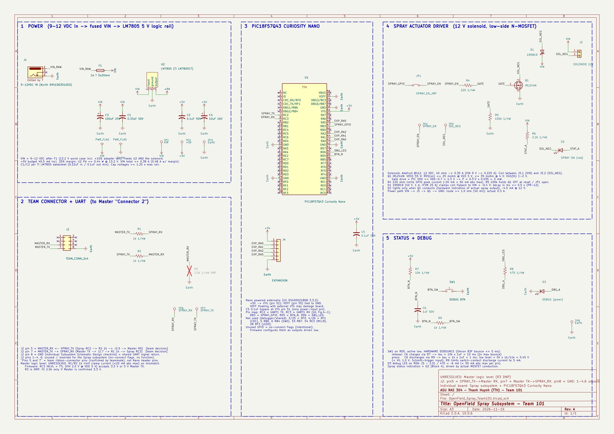

# Spray Actuator Subsystem — Final Schematic

## Overview

This page presents the final schematic of my individual subsystem, the **Spray Actuator**, for the **OpenField** project (**Team 101**, designer Thanh Huynh — TTH).
The subsystem receives spray commands from the team's Master board over UART and drives a 12 V solenoid valve through a logic-level MOSFET. It is powered from a 9–12 V DC input that also supplies a local 5 V rail for the microcontroller.

[**Download Final Schematic PDF**](Huynh_Thanh_Team101_Schematic.pdf){ .md-button .md-button--primary }

**Figure 1:** Final schematic — OpenField Spray Actuator subsystem, Team 101 (click to enlarge, or download the PDF for full resolution).

## Design Summary

| Function | Implementation |
|:--|:--|
| **Controller** | Microchip **PIC18F57Q43 Curiosity Nano** (U1), mounted on two 1×28 sockets. The external 5 V rail feeds the Nano's VTG pin, and VOFF is tied to GND. |
| **Power input** | **9–12 V DC** barrel jack (J1), with test point TP1 on the input rail (VIN). |
| **Fuse** | **Removable** 1 A time-lag 5×20 mm fuse (F1) in two Keystone 3517 clips, between the jack and the VIN rail. |
| **5 V regulator** | **LM7805** (U2, TO-220) with 0.33 µF input and 0.1 µF / 10 µF output capacitors, a 100 µF bulk capacitor on VIN, and 0.1 µF decoupling at the Nano. Test point TP2 on +5V. |
| **Solenoid driver** | **IRLZ44N** logic-level N-MOSFET (Q1) as a low-side switch. Gate driven from RB3 through the SPRAY_EN jumper (JP1) and a 220 Ω gate resistor, with a 100 kΩ gate pull-down so the solenoid stays off at reset. |
| **Flyback protection** | **1N5819** Schottky diode (D1) across the solenoid (cathode to VIN, anode to the MOSFET drain). |
| **Actuator** | **12 V solenoid** valve connected at the 2-pin screw terminal J5 (+ = VIN, − = MOSFET drain). A red "SPRAY ON" LED (D2, 2.2 kΩ) lights while the solenoid is energized. |
| **UART to Master** | Nano UART on RC2 (TX) / RC3 (RX) with 1 kΩ series resistors, through the 2×4 team ribbon header **J2**. R3 is an optional, unpopulated (DNP) level-shift resistor position. |
| **Debug LED** | Green debug LED (D3) on RD6 through a 470 Ω resistor. |
| **Pushbutton** | **Hardware-debounced** pushbutton (SW1) on RD5: 10 kΩ pull-up, 1 kΩ series resistor and 1 µF capacitor (RC debounce). |
| **Test points** | TP1 VIN, TP2 +5V, TP3/TP8 GND, TP4 SPRAY_EN, TP5 solenoid drain, TP6 SPRAY_RX, TP7 SPRAY_TX. |
| **Expansion header** | J4 (1×6): +5V, RA0, RA1, RA2, RA5, GND. |

### Team UART connector (J2)

| J2 pin | Signal | Direction |
|:--:|:--|:--|
| **5** | Spray TX → Master RX | Spray subsystem → Master |
| **7** | Master TX → Spray RX | Master → Spray subsystem |
| **8** | GND | Shared signal return |
| 1–4, 6 | Not used (reserved) | — |

## Verification

The schematic passes KiCad ERC with **0 errors and 0 warnings**, and all 72 critical pin-to-net connections were checked against the netlist with 0 failures.

## Resources

- [Download Final Schematic PDF](Huynh_Thanh_Team101_Schematic.pdf)
- Full KiCad project and manufacturing files: see the [PCB page](../06-PCB/PCB.md).
