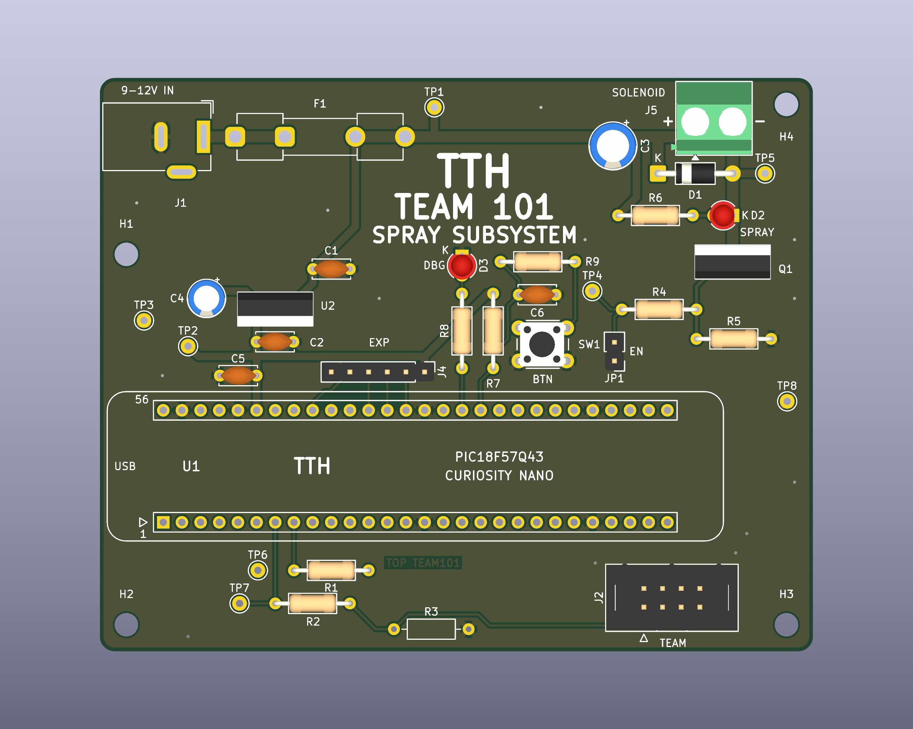
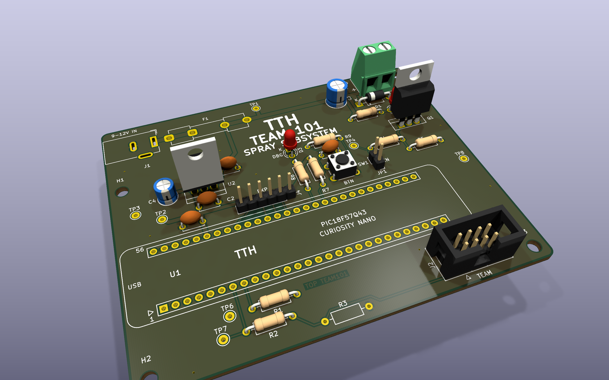
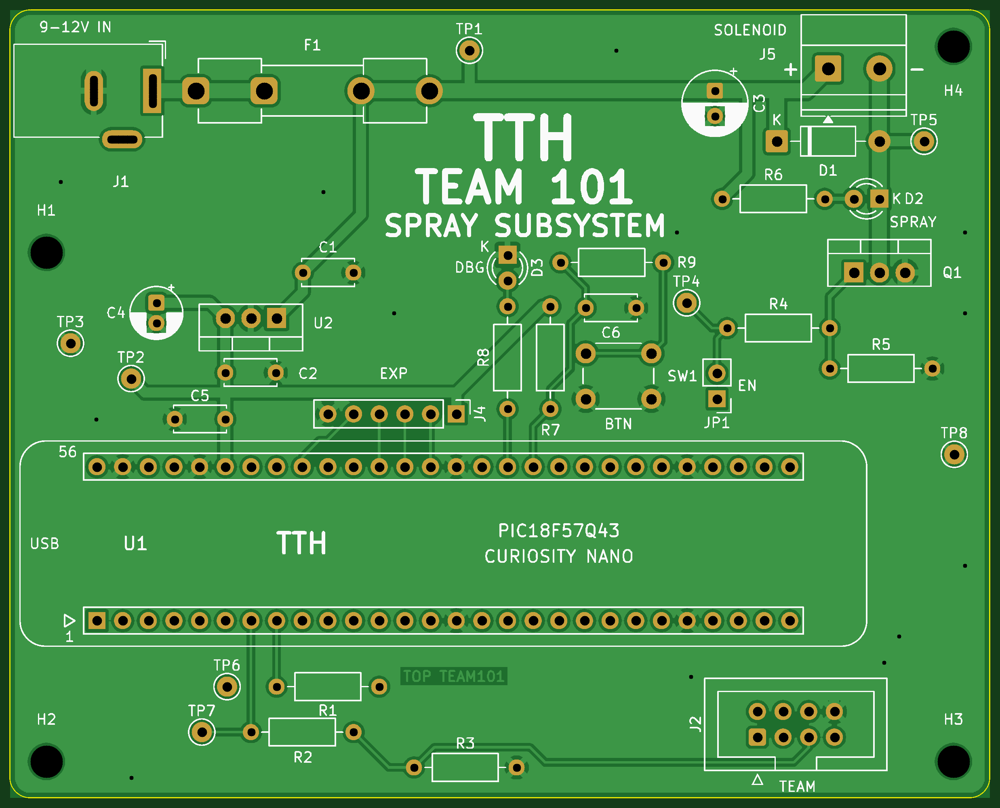
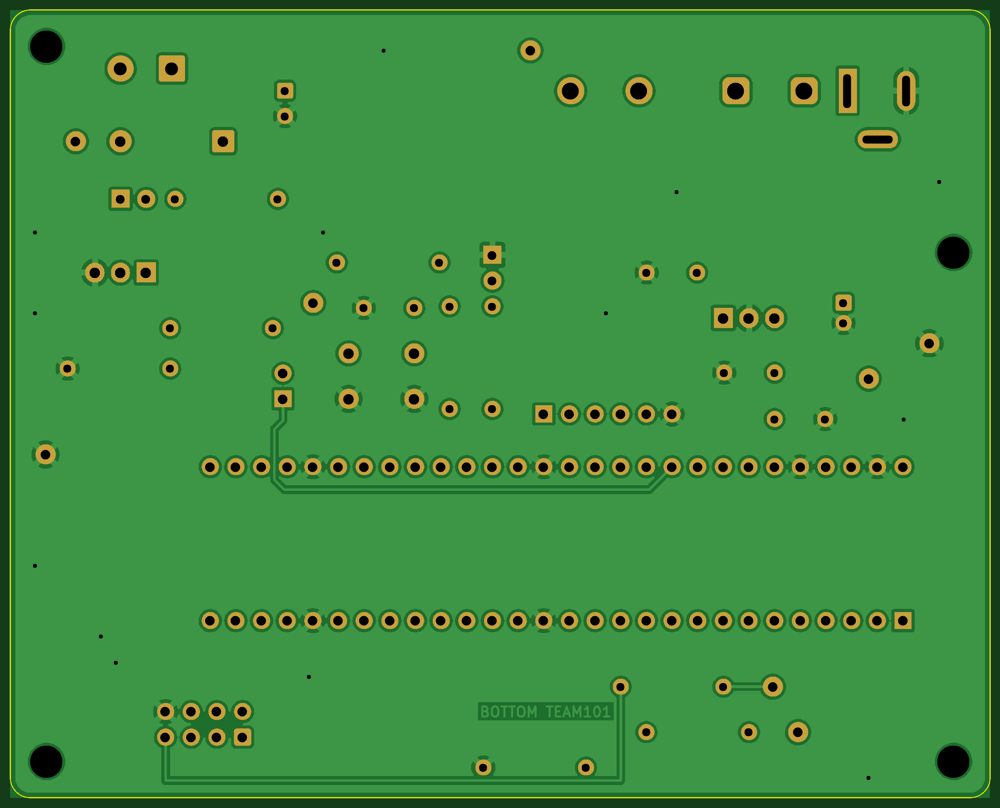
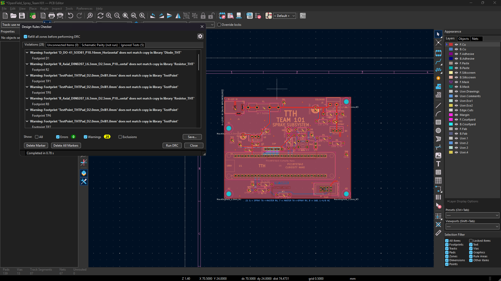
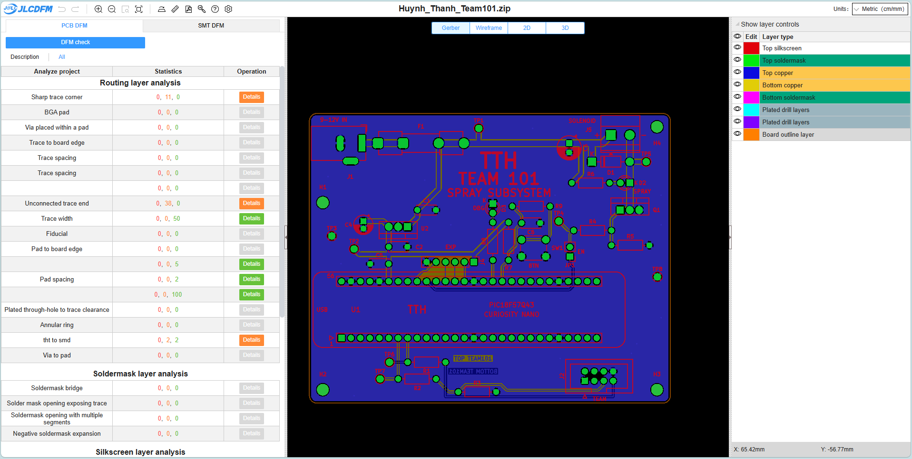

# Spray Actuator Subsystem — PCB Design

**Figure 1:** Final PCB, 3D top view (KiCad render; the Curiosity Nano itself is not modeled and is shown by its outline U1).

[**Download Final ECAD Project ZIP**](Huynh_Thanh_Team101_ECAD.zip){ .md-button .md-button--primary }
[**Download Manufacturing Gerber ZIP**](Huynh_Thanh_Team101.zip){ .md-button .md-button--primary }

## Final Specifications

| Item | Value |
|:--|:--|
| Project | OpenField |
| Team | 101 |
| Designer | Thanh Huynh (TTH) |
| Subsystem | Spray Actuator |
| Board size | 97 × 78 mm |
| Layers | 2 |
| Controller | PIC18F57Q43 Curiosity Nano |
| Actuator | 12 V solenoid |
| Communication | UART |

## PCB Design Summary

- **Functional placement.** The board is arranged by function: power input along the top-left edge, the solenoid driver in the top-right corner, the regulator, LEDs, button and expansion header in the middle, the Curiosity Nano across the lower half, and the team UART header J2 in the bottom-right corner. Four M3 mounting holes sit near the corners.
- **9–12 V to 5 V power section.** Barrel jack J1 → removable fuse F1 → VIN rail → LM7805 (U2) → +5 V rail for the Nano and logic. Input, output and bulk capacitors sit next to the regulator.
- **Solenoid / MOSFET high-current routing.** The main VIN and solenoid-current paths (J1 → F1 → J5 → Q1) use 1.5 mm traces; short low-current branches (≤ 50 mA) and +5 V / GND use 1.0 mm. The flyback diode D1 sits directly beside terminal J5 and MOSFET Q1 to keep the switching loop small.
- **Ground planes on both layers.** Both copper layers are filled with GND and joined by stitching vias, giving every signal a continuous return path.
- **UART interface.** SPRAY_TX and SPRAY_RX run from the Nano (RC2/RC3) through 1 kΩ series resistors to J2 pins 5 and 7, with pin 8 as GND. They are routed at least 30 mm away from the high-current solenoid traces.
- **USB accessibility.** The Nano's USB connector faces the left board edge (marked "USB"), so it can be programmed and debugged while mounted.
- **Test points / debugging.** Eight labelled test points (VIN, +5V, two GND, SPRAY_EN, solenoid drain, SPRAY_RX, SPRAY_TX), a green debug LED, a red "SPRAY ON" LED, a debounced pushbutton, a SPRAY_EN jumper (JP1) and a 6-pin expansion header (J4).
- **Silkscreen.** Designer and team identification (TTH, TEAM 101, SPRAY SUBSYSTEM), connector labels, pin-1 markers and polarity marks (+/−, K, triangles). All silkscreen lines are at least 0.15 mm wide and at least 0.2 mm from any pad.

**Figure 2:** Final PCB, 3D angled view.

**Figure 3:** Top layout (left) and bottom layout, mirrored (right), rendered from the final manufacturing Gerbers: copper, solder-mask openings, silkscreen and drills.

## Verification

| Check | Result |
|:--|:--|
| ERC | **0 errors, 0 warnings** |
| DRC Errors | **0** |
| Unconnected Items | **0** |
| Schematic/PCB Mismatches | **0** |
| 1:1 Physical Fit Check | **PASS** |
| JLCDFM Danger / Manufacturing Errors | **0** |
| Board Size | **97 × 78 mm** |
| Copper Layers | **2** |

*Notes:* KiCad DRC also lists 28 reviewed warnings of the type "footprint does not match copy in library". They come only from intentional silkscreen trimming, done to meet JLCDFM's silkscreen-to-pad clearance; pads, drills, copper and solder mask match the library footprints exactly. JLCDFM's non-blocking warnings are visible in the screenshot below.

**Figure 4:** KiCad 10 DRC: 0 errors, 0 unconnected items (28 reviewed library-comparison warnings).

**Figure 5:** JLCDFM analysis of `Huynh_Thanh_Team101.zip`.

## Downloads

- [Download Final ECAD Project ZIP](Huynh_Thanh_Team101_ECAD.zip): KiCad 10 project, schematic, PCB, library tables and the custom symbol and footprint libraries (`T_Library.kicad_sym`, `TTH.pretty`).
- [Download Manufacturing Gerber ZIP](Huynh_Thanh_Team101.zip): 7 Gerber layers (F/B copper, F/B mask, F/B silkscreen, board outline) plus PTH and NPTH Excellon drill files.
- Schematic: see the [Schematic page](../04-Schematic/schematic.md).
